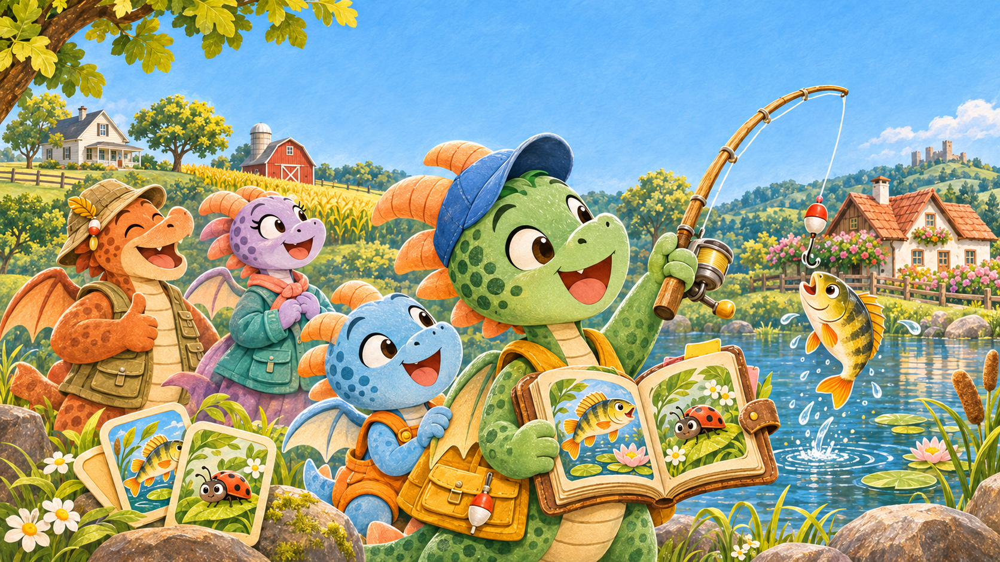

# Adamovy dračí výpravy — příběhové questy

[Hrát](https://sinaglr-eng.github.io/adams-dragon-adventures/) · [Pro babi a dědu](https://sinaglr-eng.github.io/adams-dragon-adventures/#grandparents)

Nová verze nabízí pět samostatných příběhových questů: Domov v Iowě, Školka doma, Domov u dědy a babi, Cyklistika s rodiči a Rybaření s Romčou. Obrázkové interakce a namluvené příběhy vedou dítě bez nutnosti číst. Anglické vysvětlení propojí význam s českým slovem, následuje obrázková volba podle českého poslechu.

Babi a děda mají české rozhraní, vlastní anglické procvičování a přípravu společného hovoru. Adamův postup dostanou **rodičem poslanou pohlednicí**, nikoli automatickou synchronizací. Původních osm kapitol a uložený postup zůstávají zachované. Audio knihovna obsahuje 392 MP3 včetně 94 nových replik.

[Jak přidat quest a jak funguje rodinná kniha](docs/QUEST_AUTHORING.md)



## Hraní

Otevřete web a klepněte na velké tlačítko. Výchozí průvodce mluví anglicky a učí česká slova; rodič může přepnout průvodce do češtiny. Atlas nabízí i opačný směr. Nových pět questů si lze vybrat podle tématu; každý si pamatuje vlastní rozehranou pozici. Původní kapitoly v deníku zachovávají své odemykání. Žádné časové tresty, ztracené série ani placené balíčky.

Na iPadu lze použít Safari → Sdílet → Přidat na plochu. Rozložení podporuje šířku i výšku, klepnutí namísto přetahování a klávesnici. Navštívené obrázky a repliky se ukládají do offline cache. Nové výpravy a dosud nepřehrané audio vyžadují připojení; nejde o plně předstaženou offline aplikaci.

## Mluvení a odměny

- **S dospělým:** Adam vysloví konkrétní slovo nebo větu, dospělý projde rodičovskou bránou a potvrdí srozumitelný výkon. Pečeť uvádí rodičovské ověření.
- **Lokální pokus:** rodič může povolit mikrofon. Dítě spustí nejvýše šestisekundový pokus, poslechne si ho a při zavření dialogu se audio zahodí. Nic se neposílá na server.
- Automatické hodnocení české dětské výslovnosti není aktivní. Hlasitost, přepis ani kliknutí ho nenahrazují. Hra funguje bez mikrofonu.
- Hot Wheels, Pokémon kartičky, svačinu, výlet či vlastní odměnu nejprve aktivuje rodič. Po splnění podmínek ověří důkazy a potvrdí skutečné předání. Každou odměnu lze předat jednou. Hra nic nenakupuje.

Syntetické hlasy pocházejí z ElevenLabs: český Petr a americký anglický Udem. Nejde o hlasové klony rodiny. Všechny soubory jsou součástí webu; hraní nevyžaduje API klíč. **Kompletní poslechová kontrola rodilým dospělým ještě neproběhla; před samostatným hraním nahrávky zkontrolujte.** Při nedostupném souboru může pomoci označený náhradní hlas zařízení, pouze pokud je dostupný správný jazyk.

## Spuštění a build

Node **22.12+**, pnpm **11.25.0**. React 19.3, Vite 8.3, TypeScript 6.0. Přístupné DOM scény a CSS animace; verze jsou připnuté lockfilem.

```sh
pnpm install --frozen-lockfile
pnpm dev
```

Lokální URL: `http://127.0.0.1:5173/adams-dragon-adventures/`.

```sh
pnpm typecheck
pnpm lint
pnpm test
pnpm kit:validate
pnpm game:validate
pnpm build
pnpm publish:prepare
```

`dev` a `build` připraví WebP z původních atlasů a zkopírují existující audio z `game-assets/audio` do pracovní veřejné složky. PNG se nemění. `build` vytvoří `dist/`; `publish:prepare` připraví výstup v kořeni repozitáře. GitHub Pages publikuje kořen větve `codex/preproduction`. Po pushi se aktualizuje web. Base musí zůstat `/adams-dragon-adventures/`. Build nikdy znovu negeneruje ani neúčtuje audio.

## Orientace v kódu

- `app/src/App.tsx`, `Game.tsx`: obrazovky, výpravy, mapa a atlas.
- `app/src/domain.ts`: události, učení, XP, podmínky a jednorázové odměny.
- `app/src/store.ts`: verzované atomické ukládání do IndexedDB.
- `Speech.tsx`, `microphone.ts`, `audio.ts`: rodičovské ověření, lokální nahrávání, hlas.
- `Parents.tsx`: nastavení, důkazy, aktivace a předání odměn, zálohy.
- `quest-content.ts`, `content/quest-packs/`: ověřovaný datový katalog příběhů.
- `Family.tsx`, `family-data.ts`: angličtina pro prarodiče a omezené rodinné pohlednice.
- `content/`: slovní zásoba, rodinný kánon, kapitoly, scénáře a původ audia.
- `art/source/`: originální grafika; `game-assets/`: publikovaná verze a zdrojové MP3.
- `tests/`: přechody, učení, odměny, migrace, obnova, transakce a mikrofon.

XP se počítají podle unikátních milníků. Pozdější vybavení vyžaduje jinou session, výpravu i úkol a alespoň 20 hodin odstupu. Evidence rozlišuje pomoc a samostatný výkon. Nejde o klinické měření.

## Zálohy a soukromí

Rodičovská část → Záloha → Stáhnout zálohu. JSON neobsahuje dětské audio. Import nejprve validuje formát, potom sloučí důkazy a zachová zde evidované předané odměny. Reset vyžaduje potvrzení a také zachovává předané odměny. Poškozená data se tiše nemažou; lze je exportovat pro obnovu.

Žádné účty, analytika, reklamy, chat ani automatická synchronizace. Postup patří prohlížeči; vymazání dat Safari ho může odstranit. Na jiném zařízení musí rodič porovnat již předané odměny. Matematická rodičovská brána chrání před náhodným klikáním, není zabezpečením účtu.

Repozitář je veřejný na přání vlastníka. Neobsahuje skutečné adresy, fotografie, dětské nahrávky, API klíče ani rodinné hlasové klony. Grafika je původní AI tvorba. Pokémon a Hot Wheels označují volitelné rodinné odměny; jejich loga a postavy se nepoužívají. Licence Nunito: [THIRD_PARTY_NOTICES.md](THIRD_PARTY_NOTICES.md).

## Ověření

Výsledky a ruční limity: [report ověření](docs/IMPLEMENTATION_REVIEW.md). Kontrolované rozměry jsou 1024×768, 1440×900 a 390×844. **Fyzický iPad se Safari nebyl v tomto prostředí dostupný**; audio, instalaci na plochu, mikrofon a výkon je ještě potřeba ověřit na zařízení. V produkci není žádný testovací adaptér pro falešné hlasové pečetě.
